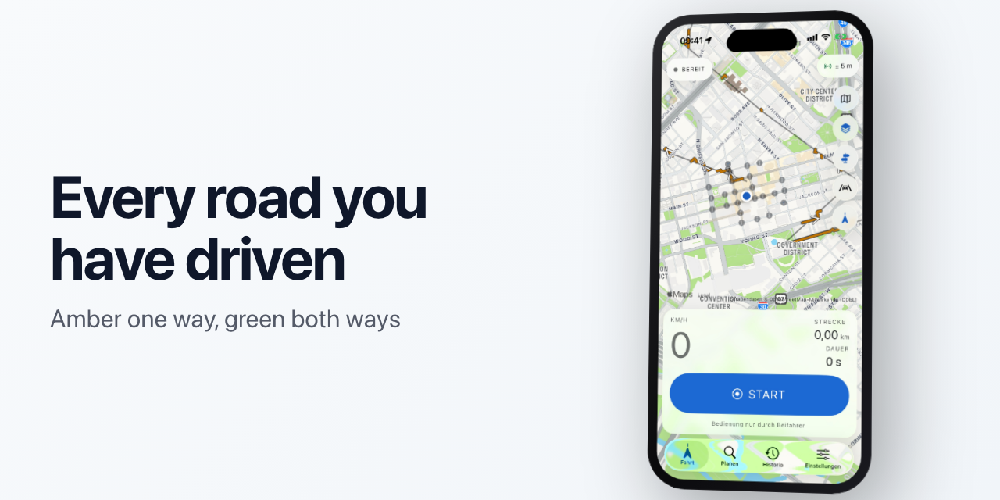
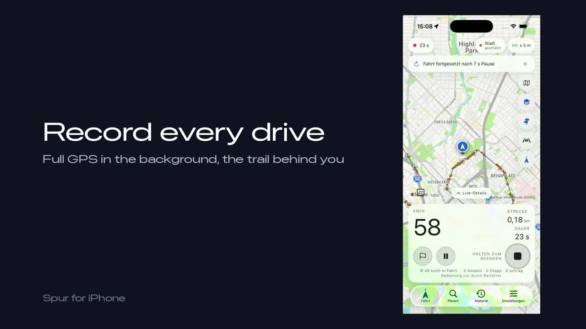
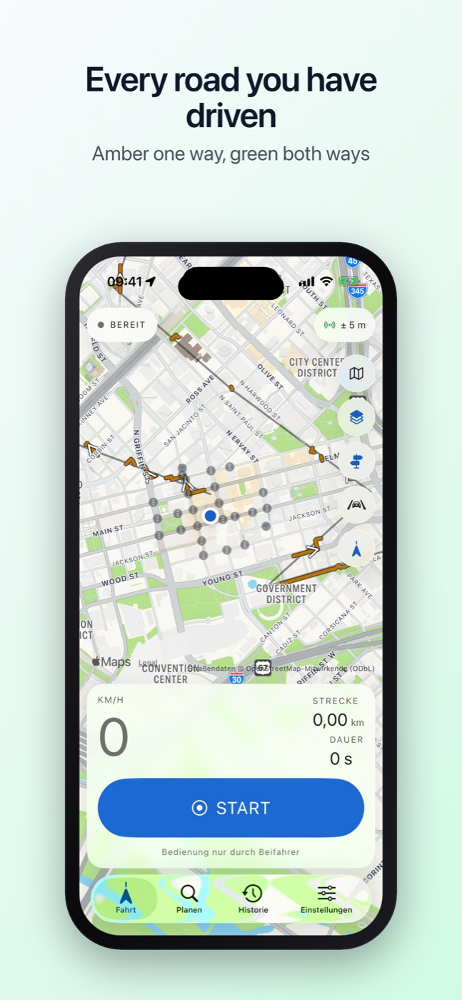
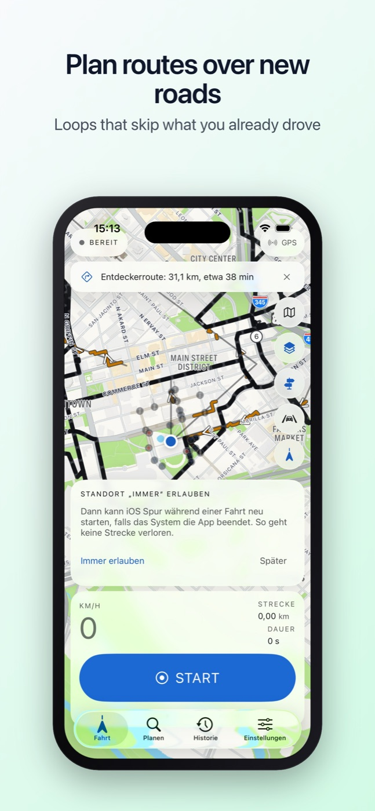
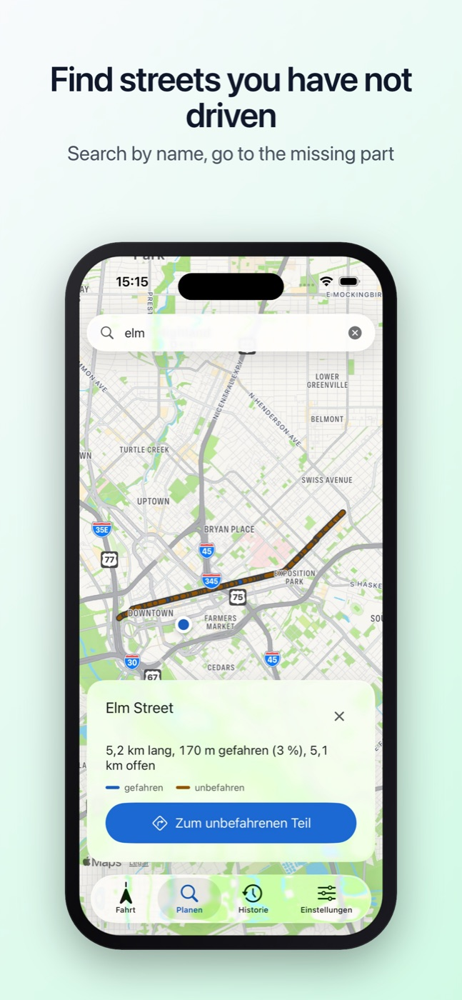
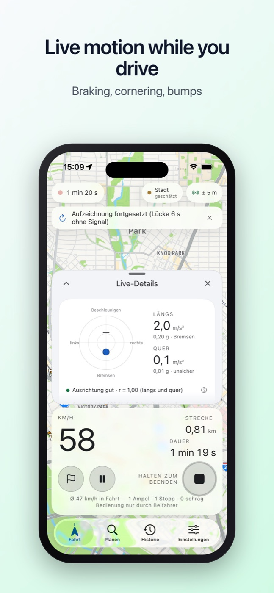
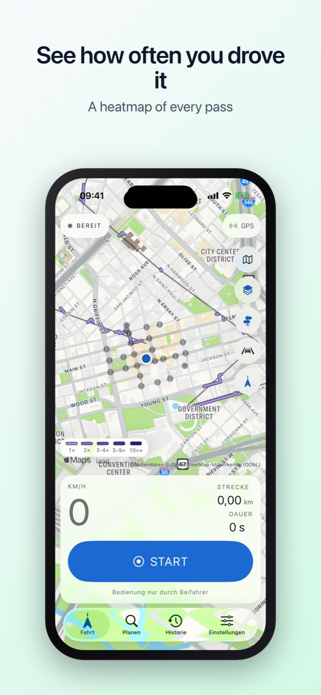
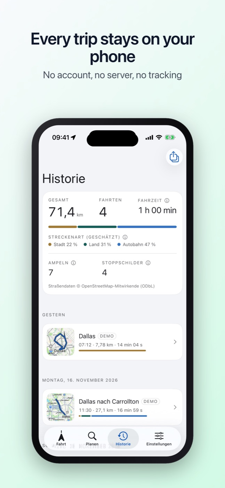

<h1 align="center">Spur</h1>

<p align="center">
  <b>Know which roads you have already driven.</b><br>
  An iPhone app that records every drive in full GPS and motion detail, shows the roads and
  directions you have covered, and plans routes over the ones you have not.<br>
  <a href="https://spur-ios.vercel.app/?utm_source=readme&utm_medium=header&utm_campaign=spur-ios">spur-ios.vercel.app</a>
</p>

<p align="center">
  
  
  
  
  
</p>

<picture>
  <source media="(prefers-color-scheme: dark)" srcset="https://raw.githubusercontent.com/noluyorAbi/spur-ios/main/docs/media/hero-dark.png">
  
</picture>

## Demo

<a href="https://github.com/noluyorAbi/spur-ios/blob/main/docs/media/spur-demo.mp4">
  
</a>

67 seconds, recorded from the app running in the iOS simulator with a simulated drive.
Nothing in it is mocked up.

## What it does

- Spur records every drive with high-accuracy GPS, in the background and with the screen
  locked, and draws the trail behind you. Raw fixes are stored exactly as the phone reports
  them and are never thinned.
- The map shows every road you have driven and in which direction: amber for one direction,
  green for both. The two carriageways of a divided road, frontage roads included, count as
  one road. A heatmap layer shows how often you drove each one.
- In the Planen (plan) tab you search a place or a street, see how much of a street you have already
  driven, and plan loops or routes to a goal that favour roads you have not driven yet. A
  route goes to Apple Maps or Google Maps, or out as a GPX file.
- The motion sensors measure braking, acceleration, cornering, bumps and the road surface.
  Spur works out how the phone sits in the car by itself, shows the values live and keeps
  them per trip.
- Traffic signals, stop signs, skewed junctions and speed limits come from OpenStreetMap and
  are counted along every trip.
- A GPS gap stays visible as a gap. Spur suggests the road you most likely took across it,
  and you accept or reject each suggestion; the recorded data is never changed.
- A long stop in a car park or on a side street becomes a pause on its own. A jam on a
  highway does not. Spur decides from the location only.
- Everything exports: GPX, CSV, GeoJSON, JSON, the raw motion samples, or all trips as one
  ZIP.

## Screens

<table>
  <tr>
    <td></td>
    <td></td>
    <td></td>
  </tr>
  <tr>
    <td></td>
    <td></td>
    <td></td>
  </tr>
</table>

The interface is in German. More screens are in [`docs/screenshots`](docs/screenshots).

## Privacy

Trips stay on the phone. There is no account, no server, no analytics and no third-party
code. What leaves the device: requests to Apple for map tiles, place search, driving times
and street names, and requests to public OpenStreetMap (Overpass) servers for the road data
of the map tiles you drive in. An Overpass request carries only the tile's bounding box,
never your fixes or your track.

## How it is built

- Swift 6 with strict concurrency, SwiftUI, MapKit, CoreLocation, CoreMotion, ActivityKit
  and WidgetKit. Apple frameworks only, no Swift packages.
- The domain logic (statistics, map matching, road coverage, the route planner, exports) is
  pure and covered by more than 370 unit tests plus a physics suite that must give
  identical results in debug and optimized builds.
- UI tests drive the real app through a full recording, export, planning and pause flow.

[`AGENTS.md`](AGENTS.md) is the guide for working on the code, for people and coding agents
alike. [`SPEC.md`](SPEC.md) is the specification the code cites section by section.
[`docs/ANLEITUNG.md`](docs/ANLEITUNG.md) is the user manual (German), and
[`docs/MOTION-FORMAT.md`](docs/MOTION-FORMAT.md) documents the motion file.

## Building it

Requires Xcode 26 with an iOS 26 simulator and [XcodeGen](https://github.com/yonaskolb/XcodeGen).

```bash
xcodegen generate
xcodebuild -project Spur.xcodeproj -scheme Spur \
  -destination 'platform=iOS Simulator,name=iPhone 17 Pro' build test
```

Without the optional offline road pack, road data loads live from OpenStreetMap. Without an
optional bundled typeface, the app uses the system font. Signing settings for a device go in
`Config/Local.xcconfig`, which is not committed.

## License

All rights reserved. The source is published to be read; it is not licensed for use,
copying or redistribution. See [`LICENSE`](LICENSE). Issues are welcome, pull requests are
not accepted.

Road data © [OpenStreetMap](https://www.openstreetmap.org/copyright) contributors, available
under the Open Database License.
